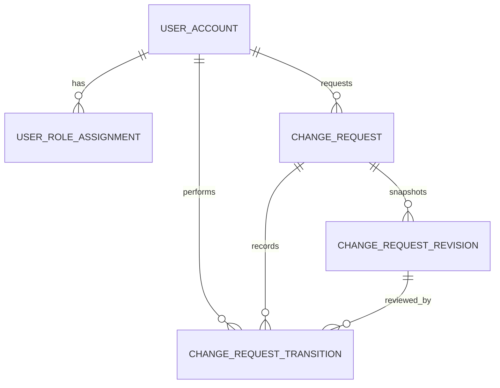
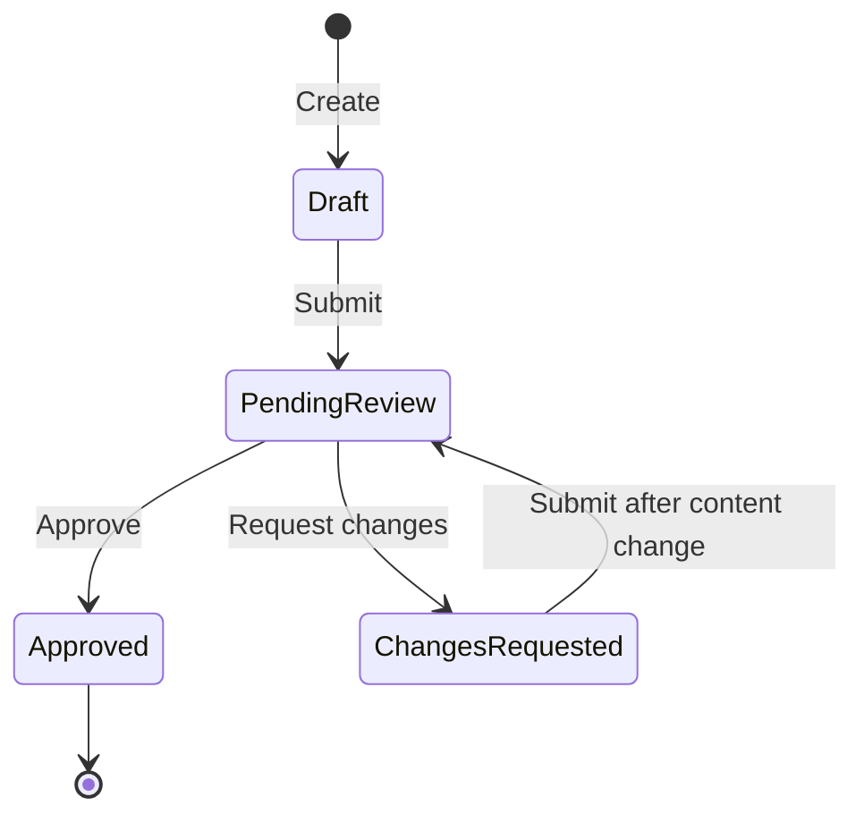

# Phase 1 Data Model: Change Request Review Workflow

**Feature**: `001-change-request-workflow`

## Domain Overview

`ChangeRequest` is the aggregate root for status transitions and current content.
`ChangeRequestRevision` preserves each submitted content snapshot.
`ChangeRequestTransition` records accepted workflow actions, reviewer feedback, and
the revision reviewed. `UserAccount` and `UserRoleAssignment` provide current
server-side authorization data.

## Workflow State Machine

`Approved` accepts no outgoing action. `Draft` and `ChangesRequested` can be edited
only by their owner. All transitions are atomic.

## UserAccount

Represents an authenticated identity whose current role state is stored by ChangeFlow.
Public user/role administration is outside this feature.

| Field | Type | Rules |
|-------|------|-------|
| `Id` | string | Primary key; stable identity from the validated token `sub` claim |
| `IsActive` | boolean | Required; inactive users fail authorization |
| `CreatedAt` | UTC date-time | Required |
| `UpdatedAt` | UTC date-time | Required |

## UserRoleAssignment

Separate rows allow a user to hold Requester and Reviewer roles simultaneously.

| Field | Type | Rules |
|-------|------|-------|
| `UserId` | string | Required foreign key to `UserAccount` |
| `Role` | enum | `Requester` or `Reviewer` |

Unique constraint: `(UserId, Role)`.

Role changes take effect on the next protected operation because every operation
loads the current role rows from the server-side store. Deactivation denies all
protected actions.

## ChangeRequest

| Field | Type | Rules |
|-------|------|-------|
| `Id` | UUID | Primary key |
| `RequesterId` | string | Required foreign key to `UserAccount`; server-assigned from caller identity |
| `Title` | string | Required after trimming; nonempty |
| `Description` | string | Required after trimming; nonempty |
| `Reason` | string | Required after trimming; nonempty |
| `Status` | enum | Required `Draft`, `PendingReview`, `Approved`, or `ChangesRequested` |
| `Version` | UUID | SQLAlchemy `version_id_col` with an application-managed UUID4 generator; changes on every accepted mutation |
| `LatestReviewedRevisionId` | UUID, nullable | Set on Request changes to the submitted revision reviewed; required for the revision-difference rule |
| `CreatedAt` | UTC date-time | Required |
| `UpdatedAt` | UTC date-time | Required |

No maximum string length or content-format rule is imposed because none was approved.

## ChangeRequestRevision

Immutable content snapshot created by a successful Submit action.

| Field | Type | Rules |
|-------|------|-------|
| `Id` | UUID | Primary key |
| `ChangeRequestId` | UUID | Required foreign key |
| `RevisionNumber` | integer | Positive and sequential per request |
| `Title` | string | Snapshot of accepted submitted content |
| `Description` | string | Snapshot of accepted submitted content |
| `Reason` | string | Snapshot of accepted submitted content |
| `SubmittedAt` | UTC date-time | Required |
| `SubmittedBy` | string | Required actor ID; must equal request owner |

Unique constraint: `(ChangeRequestId, RevisionNumber)`.

Revisions are append-only. Draft edits do not create revisions; each accepted
submission does. A resubmission is allowed only if current normalized content differs
from the revision referenced by `LatestReviewedRevisionId`.

## ChangeRequestTransition

Immutable record of an accepted state transition.

| Field | Type | Rules |
|-------|------|-------|
| `Id` | UUID | Primary key |
| `ChangeRequestId` | UUID | Required foreign key |
| `ActorId` | string | Required authenticated actor |
| `Action` | enum | `Submit`, `Approve`, or `RequestChanges` |
| `FromStatus` | enum | State before the accepted action |
| `ToStatus` | enum | State after the accepted action |
| `Comment` | string, nullable | Required nonblank only for `RequestChanges`; immutable |
| `ReviewedRevisionId` | UUID, nullable | Required for `RequestChanges`; references the submission revision reviewed |
| `OccurredAt` | UTC date-time | Required |

Only accepted transitions create rows. Failed, unauthorized, duplicate, and
concurrency-conflicting actions create no transition record.

## Transition and Authorization Matrix

| Current status | Action | Current-role requirement | Relationship requirement | Result |
|----------------|--------|--------------------------|--------------------------|--------|
| none | Create | Requester | Caller becomes owner | Draft |
| Draft | Edit content | Requester | Owner | Draft |
| Draft | Submit | Requester | Owner | PendingReview |
| PendingReview | Approve | Reviewer | Caller is not owner | Approved |
| PendingReview | Request changes | Reviewer | None; owner may request changes on own request | ChangesRequested |
| ChangesRequested | Edit content | Requester | Owner | ChangesRequested |
| ChangesRequested | Submit | Requester | Owner and current content differs from latest reviewed revision | PendingReview |
| Approved | Any edit or transition | None | None | Rejected |
| Any other combination | Any action | None | None | Rejected |

## Request Visibility

| Caller | Can view |
|--------|----------|
| Requester | Requests they created |
| Reviewer | Other users' `PendingReview` requests and requests where they made a prior Approve or Request changes decision |
| Both roles | Union of the applicable Requester and Reviewer visibility sets |
| Unauthenticated | Nothing |

Transition history and reviewer comments inherit the same request visibility. A
caller who cannot view a request cannot view its history.

## Validation Rules

### Create and Content Edit

- Trim surrounding whitespace before validation and persistence.
- Reject an empty title, description, or reason.
- Ignore or reject requester ID and status supplied by clients; the routes do not
  accept either as editable input.
- Reject content edits unless status is `Draft` or `ChangesRequested` and caller is
  the owner with a current Requester role.

### Request Changes

- Require a current Reviewer role.
- Allow the caller to be the request owner.
- Require a nonblank comment after trimming.
- Require current status `PendingReview`.
- Reference the latest submitted revision as reviewed.

### Resubmission

- Require current status `ChangesRequested`.
- Require caller to be the owner with a current Requester role.
- Compare normalized title, description, and reason with
  `LatestReviewedRevisionId`; at least one must differ.
- Reject unchanged resubmission without changing status, version, or history.

### Concurrency

- Every mutable operation accepts the current ETag through If-Match.
- A missing If-Match is a precondition failure.
- A stale version is a concurrency conflict.
- The concurrency check is repeated in the database write so a version change between
  application validation and commit fails atomically.
- SQLAlchemy emits a version-checked UPDATE and raises `StaleDataError` when another
  transaction changed the request.
- No automatic merge, retry, or last-write-wins behavior is allowed.

## Persistence Constraints and Indexes

- Alembic migrations create foreign keys for Change Request requester, revision request, transition request,
  transition actor, transition reviewed revision, and role assignment user.
- Unique: user role assignment and `(ChangeRequestId, RevisionNumber)`.
- Index: `ChangeRequest(Status, RequesterId)` for pending/owned access queries.
- Index: `ChangeRequestTransition(ChangeRequestId, OccurredAt)` for ordered history.
- Index: `ChangeRequestTransition(ActorId, Action, ChangeRequestId)` for Reviewer history access.
- `Comment` requirement for RequestChanges is enforced by Domain and a database check
  constraint where supported.
- Request, revision, and transition changes are saved in one transaction.

## Requirement Traceability

| Model area | Requirements |
|------------|--------------|
| Identity and current roles | FR-001, FR-018, FR-022, SC-005, SC-006 |
| Request content validation | FR-004, FR-028, SC-013 |
| Draft create/edit/submit | FR-002, FR-003, FR-005, FR-006, FR-007, FR-013 |
| Review decisions | FR-008, FR-009, FR-010, FR-025, SC-002, SC-010 |
| ChangesRequested revision | FR-011, FR-012, FR-021, FR-027, SC-012 |
| Approved immutability | FR-015, SC-004 |
| Concurrency and atomicity | FR-016, FR-017, FR-026, SC-003, SC-009 |
| Visibility and audit access | FR-023, FR-029, SC-015 |
| Duplicate/invalid actions | FR-013, FR-014, FR-019, SC-001, SC-014 |
